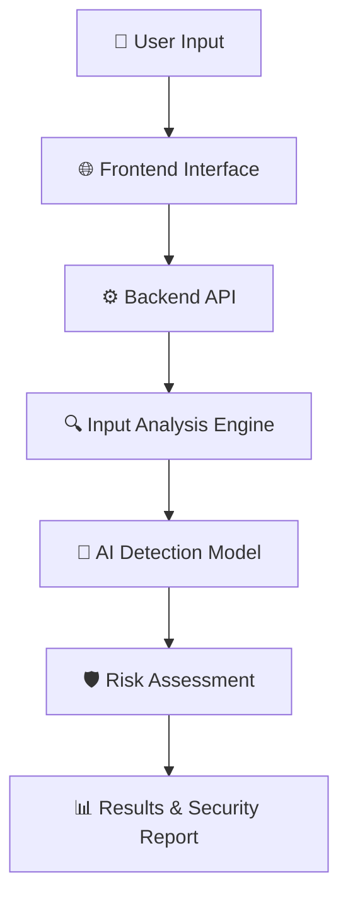

# 🛡️ ScamShield AI
### AI-Powered Scam Detection & Digital Fraud Intelligence Platform

<p align="center">
  
  
  
  
</p>

<p align="center">
  **Detect suspicious activity. Identify digital scams. Stay protected.**
</p>

---

## 🌐 Overview

**ScamShield AI** is an AI-powered cybersecurity project designed to help identify potentially fraudulent messages, suspicious links, phishing attempts, and digital scam patterns.

The platform aims to analyze submitted content, identify suspicious indicators, and provide understandable risk assessments to help users make safer digital decisions.

> 🔍 Building smarter digital protection through Artificial Intelligence and security intelligence.

---

## ⚡ Core Capabilities

| Feature | Description |
|---|---|
| 📨 Message Analysis | Analyze suspicious SMS, emails, and text messages. |
| 🔗 URL Risk Analysis | Inspect URLs for potentially suspicious patterns. |
| 🎣 Phishing Detection | Identify common phishing indicators. |
| 🤖 AI-Based Classification | Classify submitted content using detection models. |
| 📊 Risk Assessment | Present risk levels and analysis results. |
| 📑 Security Reports | Generate structured analysis reports. |

*Capabilities depend on the features implemented in the current version.*

---

## 🧠 System Architecture



---

## 🛠️ Technology Stack

| Layer | Technology |
|---|---|
| Programming Language | Python |
| Frontend | HTML, CSS, JavaScript / React |
| Backend | Flask / FastAPI |
| AI & Machine Learning | Scikit-learn / NLP |
| Data Processing | Pandas, NumPy |
| Database | SQLite / PostgreSQL |
| Version Control | Git & GitHub |

*Update this table to match the technologies actually used in your repository.*

---

## 📂 Project Structure

```text
ScamShield-AI/
│
├── backend/
│   ├── app/
│   ├── detection/
│   ├── models/
│   └── services/
│
├── frontend/
│   ├── static/
│   ├── templates/
│   └── src/
│
├── data/
├── reports/
├── tests/
│
├── app.py
├── requirements.txt
├── .gitignore
└── README.md
```

*Illustrative structure — adjust it to your actual project folders.*

---

## 🚀 Installation & Setup

### 1. Clone the Repository

```powershell
git clone YOUR_G
